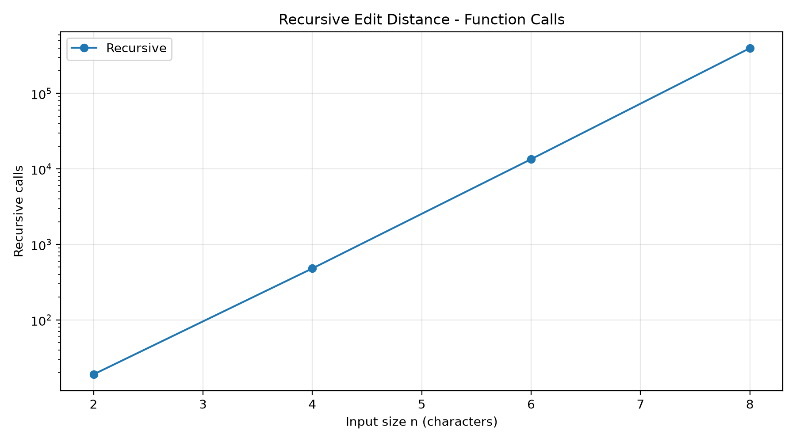
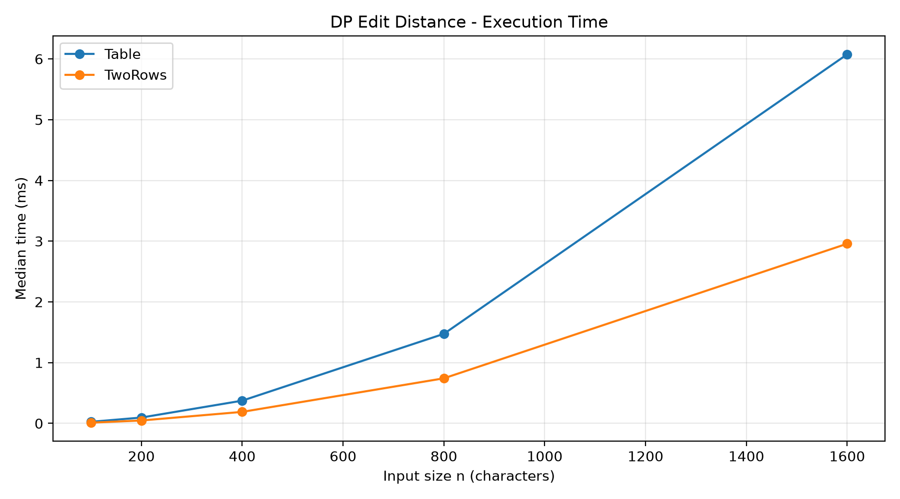
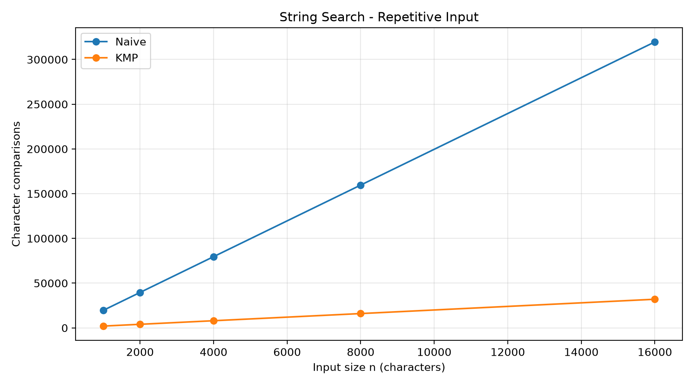
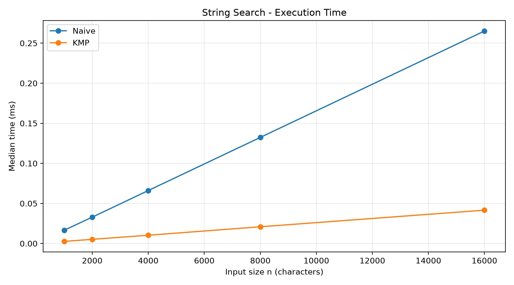

# Assignment 4 — Dynamic Programming and String Algorithms

## 1. Experiment Design Card

**Questions**

- Edit Distance: How does the cost of recursive, table and two-row implementations change as string length increases?
- String Search: How do Naive Search and KMP perform on random and repetitive text?

**Input sizes**

- Recursive Edit Distance: 2, 4, 6, 8 characters.
- Table and TwoRows: 100, 200, 400, 800, 1600 characters.
- String Search: text lengths 1000, 2000, 4000, 8000, 16000, with a pattern length of 20.

**Input types**

For Edit Distance, I used random strings and two different repeated strings (`aaaa...` and `bbbb...`). The second type makes recursion explore many possibilities.

For String Search, I used random strings and repetitive text. The difficult case contains many `a` characters, while the pattern ends with `b`. This creates many partial matches for Naive Search.

**Metrics and predictions**

I measured recursive calls, DP cell updates, character comparisons and execution time. I used a fixed random seed of 42. For time measurements, I warmed up the JVM, averaged 100 executions per measurement and used the median of five measurements.

I expected recursion to grow very quickly, both DP implementations to have approximately quadratic time complexity, and KMP to perform fewer comparisons on repetitive text. I also expected TwoRows to require less memory than the full table.

## 2. Results and Plots

### Recursive Edit Distance

The number of recursive calls increased from 19 at n = 2 to 398,593 at n = 8 for different repeated strings. This shows how expensive direct recursion becomes when it repeats similar calculations. The graph uses a logarithmic vertical axis.

### DP Edit Distance

Both Table and TwoRows became slower as input size increased. At n = 1600, Table took about 6.1 ms and TwoRows took about 3.0 ms on the different-string input. Both implementations performed 2,560,000 DP cell updates.

### Naive Search and KMP Comparisons

On repetitive text, Naive Search performed many more character comparisons than KMP. At n = 8000, Naive used 159,620 comparisons while KMP used 16,018 comparisons. The LPS array helped KMP avoid checking the same text characters repeatedly.

### String Search Execution Time

KMP was faster than Naive Search on repetitive text in this experiment. At n = 16000, Naive took approximately 0.265 ms and KMP took approximately 0.042 ms. These results support my prediction for this particular input type.

## 3. Prediction vs. Results

For Edit Distance, I expected the recursive version to become expensive quickly. The results confirmed this because its number of function calls increased sharply even for short strings. The two DP implementations showed much more predictable growth. TwoRows was faster in the measured cases, but its main theoretical advantage is lower memory usage.

For String Search, I expected KMP to perform better on repetitive text. The comparison counts and execution times supported this prediction. On random strings, the difference was less clear because Naive Search often found mismatches quickly.

## 4. Short Answers

**Which input made string search slowest, and why?**

The repetitive text was the most difficult input for Naive Search in my experiment. The text contained many `a` characters and the pattern ended with `b`. Naive Search checked many characters before finding a mismatch. KMP avoided repeating much of this work by using the LPS array.

**How large an n could recursive Edit Distance handle, and what stopped it?**

I tested recursive Edit Distance up to n = 8. At this size, the different-string case already required 398,593 recursive calls. The algorithm could handle larger strings, but the number of repeated calculations would increase rapidly. I limited its input sizes to keep the experiment practical.

**What do you gain and lose by using two rows instead of a full table?**

TwoRows uses much less extra memory because it stores only the previous and current rows. It has the same O(n·m) time complexity as the full table. However, the two-row version does not keep the complete DP table, so reconstructing the sequence of edits becomes less straightforward.

**Which string search would you choose for the city platform?**

I would choose KMP for searching long logs, especially when the text contains repeated characters. It guarantees linear-time searching after preprocessing the pattern. Naive Search is simpler and can work well for short or random text. However, KMP offers more predictable performance for difficult inputs.

## 5. Notes on Execution Time

Execution time can change depending on the computer, JVM optimization and other running processes. Some short operations take only a small fraction of a millisecond, so timing results may contain noise. I used JVM warm-up, repeated measurements and medians to reduce this problem. I also used operation counters because they provide more stable evidence of algorithm behavior.

## 6. Conclusion

This experiment helped me understand why dynamic programming is useful for Edit Distance and why KMP is effective for repetitive text. The results showed that recursive solutions can repeat a lot of work, while DP avoids this problem. TwoRows uses less memory than Table, and KMP made fewer comparisons than Naive Search on difficult inputs. The graphs were generated from the measured results stored in `results.csv`.